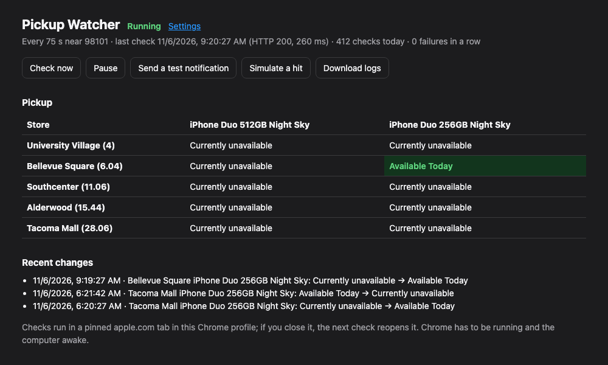
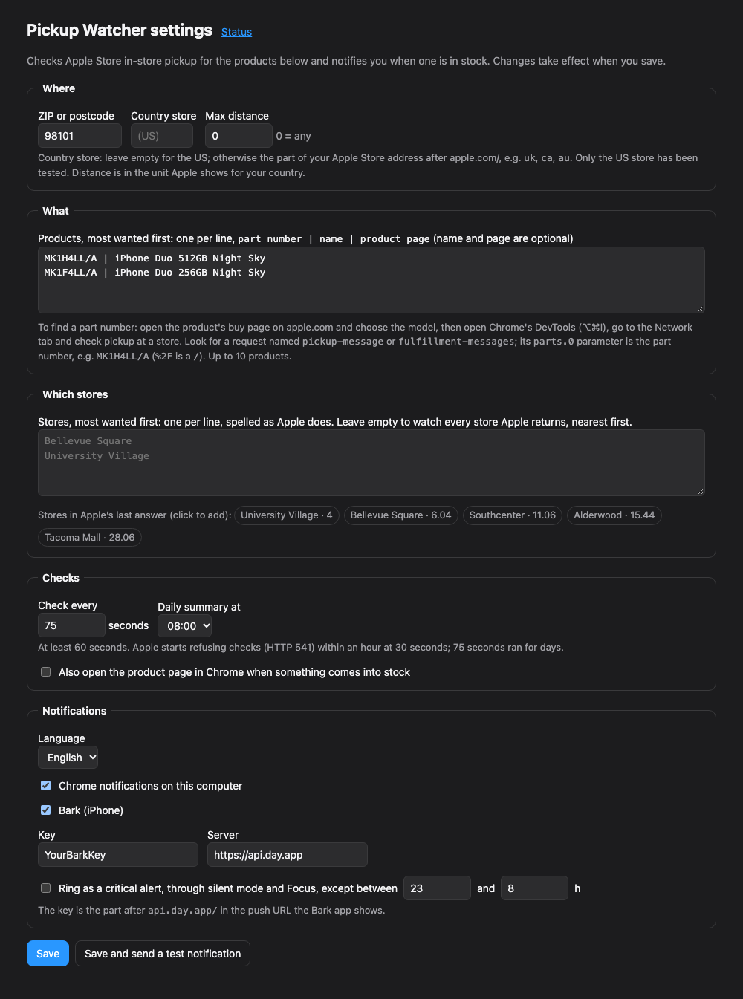

# Pickup Watcher for Apple Store

A Chrome extension that watches Apple Store **in-store pickup** for the products and stores you choose. When one comes into stock it notifies you on your computer, and on your iPhone through [Bark](https://github.com/Finb/Bark).

[中文说明](README.zh-CN.md)



- **Any product, any store:** up to 10 Apple part numbers, ranked by preference. Watch the stores you list, in your order, or every store near a ZIP/postcode, nearest first.
- **Runs in your own Chrome.** It needs no server, account or API key. It makes the same request apple.com makes when you check a store, from a pinned apple.com tab.
- **Polite by design:**
  - It checks at most once a minute.
  - When Apple pushes back it pauses for 10, 30, then 60 minutes.
  - Only one request is ever in flight.
- **Notifications:**
  - Chrome notifications, with no setup.
  - Bark (iPhone). It can ring as a critical alert through silent mode, with quiet hours.
  - A hit links to the product page. Reminders repeat while it lasts, and another notification comes when it's gone.
- **English or Chinese** notifications.

## Install

1. Download this repository (Code → Download ZIP, then unzip it) or `git clone` it.
2. In Chrome, open `chrome://extensions` and turn on **Developer mode** (top right).
3. Click **Load unpacked** and choose the `extension` folder.
4. The settings page opens. Fill it in and click **Save**.

Click the extension's toolbar icon to see the status page.

## Settings



| Setting | What it does |
| --- | --- |
| ZIP or postcode | Where to look for stores. Apple returns the stores near it. |
| Country store | Leave empty for the US. Otherwise use the part of your Apple Store address after `apple.com/`, e.g. `uk`, `ca`, `au`. Only the US store has been tested. |
| Max distance | Ignore stores farther than this, in Apple's unit for your country. `0` means no limit. |
| Products | One per line, most wanted first: `part number \| name \| product page`. The name and page are optional. The page is where a notification leads. |
| Stores | One per line, most wanted first, spelled as Apple does. Leave it empty to watch every store Apple returns. After the first check, the settings page lists the stores Apple returned, and you can click one to add it. |
| Check every | Seconds between checks: at least 60, default 75. Each check gets 0–15 s of random jitter. |
| Daily summary | An optional daily notification with the number of checks and what's in stock. |
| Open the product page | Also opens the product page in Chrome on a hit. |

### Finding a part number

Apple sells each configuration under a part number such as `MK1H4LL/A`. The `LL/A` ending is the US one. To find it:

1. Open the product's buy page on apple.com and choose the exact model (size, color, carrier…).
2. Open DevTools (⌥⌘I on a Mac, Ctrl+Shift+I elsewhere) and go to the **Network** tab.
3. On the page, check pickup availability at a store.
4. Look for a request named `pickup-message` or `fulfillment-messages`. Its `parts.0` parameter is the part number (`%2F` is `/`).

Accessories often show the part number in the page address, e.g. `apple.com/shop/product/MX542AM/A/...`.

## Notifications

- **Chrome:** on by default. On a Mac, allow notifications for Google Chrome in System Settings → Notifications.
- **Bark (iPhone):**
  1. Install [Bark](https://github.com/Finb/Bark) from the App Store.
  2. Copy the key from the push URL it shows: the part after `api.day.app/`. Paste it into the settings.
  3. Optionally turn on **critical alert**: a hit then rings through silent mode and Focus, except in the quiet hours you set. iOS asks you to allow critical alerts for Bark the first time.
- **Self-hosted Bark server:** you can use your own. Chrome asks for permission to reach it when you save.

**Save and send a test notification** checks every channel you turned on.

## How it works

- Every check runs `GET /shop/retail/pickup-message?parts.0=…&location=…` inside a pinned, inactive apple.com tab in your Chrome profile. One request covers every product and every nearby store.
- A store counts as "in stock" when Apple's `pickupDisplay` says `available`. If that flag is missing, the quote text decides, e.g. "Available Today".
- If you close the tab, the next check reopens it. If you close every window, it opens a minimized one.
- **When Apple pushes back:** HTTP 541 (Apple's throttle), 403 or 429, a sign-in redirect, or an HTML page instead of JSON all trigger a pause of 10, 30, then 60 minutes. You get one notification, and another when checks recover.
- **Other failures:** a single 5xx is retried at the normal pace. Five failures in a row (network, timeouts) send one notification.
- The status page shows the last answer for every store. **Download logs** saves seven days of checks and changes. It leaves out your settings, which hold your push keys.

### Rate limits: what we learned

- **Every 30 s:** Apple started answering HTTP 541 within about an hour, every hour.
- **Every 60–75 s:** ran for days with only rare, short 541s. That is why the minimum is 60 s and the default is 75 s.
- **Don't multiply requests.** Run one copy in one Chrome profile per network. More copies, profiles or computers behind the same IP don't find stock faster; they get you throttled sooner.

## Limitations

- **Chrome must be running and the computer awake.** On a Mac, `caffeinate -i` in a terminal keeps it awake.
- **Pickup availability is per part number.** Carrier deals, trade-in or financing options aren't checked. Confirm on the buy page before you order.
- **The endpoint is undocumented.** Apple can change it at any time. The tests and `tools/dry-run.mjs` replay saved answers, so you can check the logic without asking Apple.
- **Outside the US it's untested.** Only the US store has been tried. Reports and fixes for other countries are welcome.

## Development

```sh
npm test          # unit tests, plus the service worker end to end against a fake chrome.* (Node 22+)
npm run dry-run   # replays fixtures/ with examples/settings.example.json and prints the notifications
node tools/dry-run.mjs --test-notify --settings my-settings.json   # sends one test push through Bark
```

```
extension/
  background.js      service worker: schedule, pinned tab, the request, notifications
  lib/logic.js       what an answer means and what to do (pure)
  lib/settings.js    defaults and validation (pure)
  lib/notify.js      Bark requests (pure)
  lib/i18n.js        notification text, English and Chinese
  options.*          settings page
  status.*           status page
tests/               node:test, no dependencies
fixtures/            saved Apple answers
tools/dry-run.mjs    replay fixtures, or send a test push, from Node
```

There are no dependencies and no build step. Edit a file, then click the reload icon on the extension in `chrome://extensions`.

## Disclaimer

This project isn't affiliated with, endorsed by, or sponsored by Apple Inc. "Apple", "Apple Store" and "iPhone" are trademarks of Apple Inc.

It's meant for personal use, to buy something for yourself. Keep the pace polite and follow Apple's terms of use. It doesn't solve CAPTCHAs, spoof browsers or rotate IPs, and it never will.

## License

[MIT](LICENSE)
