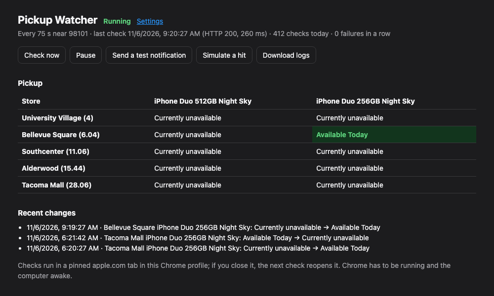
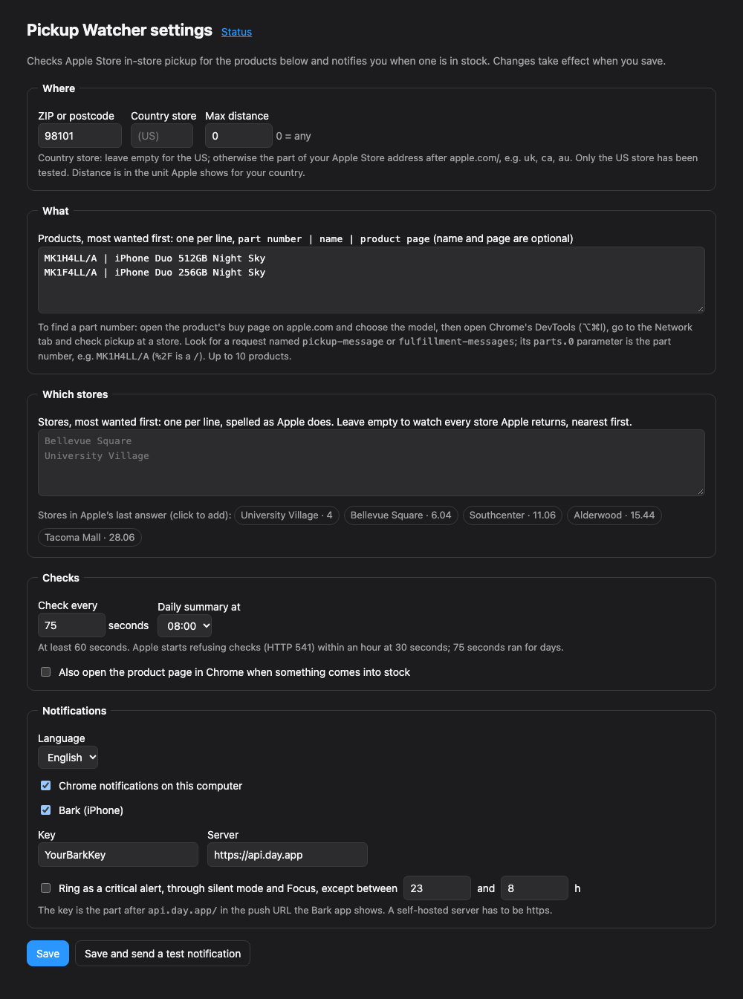

# Pickup Watcher for Apple Store（Apple Store 到店取货监控）

一个 Chrome 扩展：盯着你指定的产品和门店的「到店取货」库存，一有货就在电脑上通知你。也可以通过 [Bark](https://github.com/Finb/Bark) 推送到 iPhone。

[English](README.md)



- **任意产品、任意门店：**
  - 最多 10 个 Apple 型号（part number），按优先级排列。
  - 可以只看你列出的门店（按你的顺序），也可以看某个邮编附近的所有门店（由近到远）。
- **在你自己的 Chrome 里跑：** 不需要服务器、账号或 API key。用一个固定的 apple.com 标签页发请求，和你在 apple.com 上查门店库存时发的请求一样。
- **克制：**
  - 定时检查至少间隔一分钟；手动 **Check now** 也要离上次检查 30 秒以上。
  - 被 Apple 拦截时依次暂停 10、30、60 分钟。暂停期间不会再查，手动检查和改设置也不行。
  - 同一时间只跑一次检查。
- **通知：**
  - Chrome 系统通知，无需设置。
  - Bark（iPhone），可选用紧急通知穿透静音，并设安静时段。
  - 点通知直接打开产品页。有货期间会重复提醒几次，没货了也会告诉你。
- **通知语言：** 中文或英文。

## 安装

1. 下载本仓库（Code → Download ZIP 后解压），或者 `git clone`。
2. Chrome 打开 `chrome://extensions`，打开右上角的「开发者模式」。
3. 点「加载已解压的扩展程序」，选 `extension` 文件夹。
4. 会自动打开设置页。填好后点 **Save**。

点工具栏上的扩展图标可以看状态页。

## 设置



- **ZIP or postcode：** 在哪附近找门店。
- **Country store：** 美国留空。其他国家填 Apple Store 网址里 `apple.com/` 后面那段，比如 `uk`、`ca`、`au`。目前只在美国测试过。
- **Max distance：** 超过这个距离的门店不看，单位按 Apple 在你所在国家用的单位。`0` 表示不限。
- **Products：** 每行一个，最想要的放最前：`型号 | 名字 | 产品页`。名字和产品页可以不填，产品页是点通知后打开的页面。
- **Stores：** 每行一个门店名，最想去的放最前，要和 Apple 的写法一致。留空表示看 Apple 返回的所有门店。第一次检查后，设置页会列出 Apple 返回的门店，点一下就能加进来。
- **Check every：** 每次检查间隔多少秒，最少 60，默认 75。每次会随机多等 0–15 秒。
- **Daily summary：** 每天一条日报，可关闭。
- **Also open the product page：** 有货时同时在 Chrome 里打开产品页。

### 怎么找型号（part number）

1. 在 apple.com 打开产品的购买页，选好具体配置（容量、颜色、运营商等）。
2. 打开开发者工具（Mac 上 ⌥⌘I），切到 **Network**。
3. 在页面上查一次门店取货。
4. 找名为 `pickup-message` 或 `fulfillment-messages` 的请求，它的 `parts.0` 参数就是型号，比如 `MK1H4LL/A`（`%2F` 就是 `/`）。

配件的型号通常直接写在网址里。

## 通知

- **Chrome：** 默认开启。Mac 上要在「系统设置 → 通知」里允许 Google Chrome 发通知。
- **Bark（iPhone）：**
  1. 在 App Store 装 Bark。
  2. 复制它显示的推送网址里 `api.day.app/` 后面那段 key，填到设置里。
  3. 可以勾选「紧急通知」：有货时穿透静音和专注模式响铃；在你设的安静时段内只是普通通知。第一次 iOS 会问是否允许 Bark 的紧急通知。
- **自建 Bark 服务器：** 也可以用，但必须是 https。保存时 Chrome 会请求访问该服务器的权限。
- **推送失败**（比如 key 填错、服务器连不上）时，状态页会一直提示，直到有一条成功送达。

**Save and send a test notification** 会向所有开启的渠道各发一条测试通知。

## 关于频率（经验）

- **每 30 秒一次：** 大约一小时内就会被 Apple 返回 HTTP 541（限流），而且每小时都会这样。
- **每 60–75 秒一次：** 能连续跑好几天，只偶尔有很短的 541。所以最小值是 60 秒，默认 75 秒。
- **同一个网络只跑一份：** 只开一个 Chrome profile。多开 profile、多台电脑或多个副本共用一个 IP，不会更快查到货，只会更快被限流。

## 限制

- **Chrome 要开着，电脑不能睡眠。** Mac 上可以在终端运行 `caffeinate -i`。
- **只按型号看库存：** 运营商合约、以旧换新、分期等不在检查范围内，下单前请在购买页确认。
- **接口随时可能变：** 这是 Apple 未公开的接口。测试和 `tools/dry-run.mjs` 用保存的响应回放，不用请求 Apple 就能验证逻辑。
- **美国以外没测试过：** 欢迎反馈和修复。

## 开发

```sh
npm test          # 单元测试，以及用假 chrome.* 端到端跑 service worker（Node 22+）
npm run dry-run   # 用 examples/settings.example.json 回放 fixtures/，打印会发的通知
```

没有任何依赖，也不需要构建。改完文件后，在 `chrome://extensions` 里点扩展的刷新按钮即可。

## 声明

本项目与 Apple Inc. 无关，也未获其认可或赞助。「Apple」「Apple Store」「iPhone」是 Apple Inc. 的商标。

本项目仅供个人自用购买。请保持合理的频率，并遵守 Apple 的使用条款。本项目不破解验证码、不伪装浏览器、不轮换 IP，以后也不会。

## 许可

[MIT](LICENSE)
